{{site.data.keyword.attribute-definition-list}}


# Deploying LLM to RedHat OpenShift AI cluster
{: #rhoai-deploy}
{: toc-content-type="tutorial"}
{: toc-services="openshift"}
{: toc-completion-time="2h"}

This tutorial will incur costs for Red Hat OpenShift cluster and associated services. Check the estimates before provisioning the services.
{: tip}

This tutorial provides step-by-step guideance for provisioning and configuring Red Hat OpenShift AI cluster (RHOAI) on IBM Cloud with NVIDIA GPUs and hosting a large language model (LLM).
{: shortdesc}

## Objectives
{: #solution-template-objectives}

You will learn how to provision and configure a Red Hat OpenShift AI cluster (RHOAI) on IBM Cloud with NVIDIA GPUs and host a large language model (LLM).

## Before you begin
{: #solution-template-prereqs}

Before starting this tutorial ensure you have completed these prerequisites.
- IBM Cloud account with IBMid
- Account must have privileges from these roles. Check [Roles to provision Red Hat OpenShift cluster](https://cloud.ibm.com/docs/openshift?topic=openshift-iam-platform-access-roles)

This tutorial provisions a Red Hat OpenShift cluster with AI add-on with following features:

* Cluster spans 2-zones of a region.
* Worker pool: single worker node per zone, i.e., total 2 worker nodes.
* Worker node profile: bx2.8x32 - 8vCPU/32GB mem.
* GPU worker pool: single GPU worker node per zone, i.e., total 2 GPU worker nodes.
* GPU worker node profile: gx3.16x80.l4 - 16vCPU/80GBmem 1 L4 NVIDIA GPU.
* Model deployed: granite-3.3-8b-instruct.


The deployment provides an LLM inferencing endpoint for use with AI/Gen AI applications.

The figure below shows the architecture of the deployment that will be done as part of this tutorial.

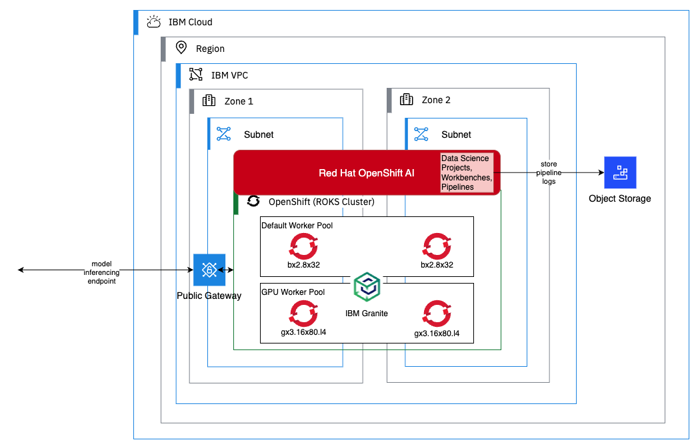{: caption="Architecture diagram of the deployment and tutorial" caption-side="bottom"}


## Steps summary
{: #p 1: Lstep-summary}

Below is a summary of the steps for completing the tutorial

1. Login to IBM Cloud account
2. Decide the geography and region where the resources will be created
3. Create a Resource group where all resources will be created
4. Create Cloud Object Storage instance for cluster images, model files etc.
5. Download the IBM granite LLM from Hugging Face repository
6. Upload the IBM granite LLM files to COS bucket
7. Create a VPC in a region, and single zone.
8. Create a Red Hat OpenShift cluster
9. Add GPU worker pool to the Red Hat OpenShift cluster
10. Enable the Red Hat OpenShift AI add-on
11. Create a Data Science Project for LLM inferencing
12. Create a connection to the COS bucket
13. Create NVIDIA GPU Accelerator
14. Deploy the LLM model
15. Verify the LLM model by inferencing

## Login to IBM Cloud account
{: #deploy-model-rhoai-login}
{: step}

Log in to [IBM Cloud console](https://cloud.ibm.com/login)

## Decide the geography and region where the resources will be created
{: #deploy-model-rhoai-geo_region}
{: step}

To help in the decision, refer to the following
- [IBM Cloud geographies, regions and locations](https://cloud.ibm.com/docs/overview?topic=overview-locations#americas-mzr)
- [GPU profiles](https://cloud.ibm.com/docs/vpc?topic=vpc-profiles&interface=ui#gputhe)

This tutorial uses the geography and region below.

| **Input** | **Decision** |
| - | - |
| Geography | E.g. South America |
| Region | E.g. Sao Paulo (br-sao) |
{: caption="Region configuration" caption-side="bottom"}

## Create a Resource group where all resources will be created
{: #deploy-model-rhoai-resource_group}
{: step}

1. In the IBM Cloud console, go to **Manage** > **Account** > **Account resources** > **Resource groups**.
2. Click **Create**.
3. Enter a name for your resource group. (see below)
4. Click **Create**.

You will need this information:

| **Input** | **Data entry/selection** |
| - | - |
| Resource group name | l4lab-pass |
{: caption="resource group information" caption-side="bottom"}


## Create Cloud Object Storage (COS) instance for cluster images, model files etc.
{: #deploy-model-rhoai-create_cos}
{: step}

1. In the IBM Cloud console, navigate to the catalog, by clicking **Catalog** in the top navigation bar.
2. In the left menu, Click the **Storage** category. Click the **Object Storage** tile.
3. Give the service instance a name and choose a plan. (see below)
4. Click **Create** and you are redirected to your new instance.

COS stores images of the cluster internal registry. A COS bucket will automatically be created for your cluster's internal registry.

It is also used to store the LLM/model files. You will create a bucket and upload yourself this yourself.


| **Input** | **Data entry/selection** |
| - | - |
| Plan | Standard |
| Service name | l4-lab-paas-cos |
| Resource group name | select resource group created earlier |
{: caption="Configuration for COS bucket" caption-side="bottom"}


## Download the IBM granite LLM from Hugging Face repository
{: #deploy-model-rhoai-download_llm}
{: step}

Read about about the [granite-3.3-8b-instruct model](https://huggingface.co/ibm-granite/granite-3.3-8b-instruct)

From your local computer, download the model files.

### Option 1: Using Hugging Face CLI
{: #option1}

Install [Hugging Face CLI](https://huggingface.co/docs/huggingface_hub/main/en/guides/cli)

Create a directory where the model will be downloaded.
```bash
cd <your local work directory>
mkdir lab-content
mkdir lab-content/granite-3.3-8b-instruct
mkdir lab-content/granite-3.3-8b-instruct/model-files
chmod -R 755 lab-content
```

Use the CLI to download the granite-3.3-8b-instruct model
```bash
cd <your local work directory>/lab-content/granite-3.3-8b-instruct/model-files
huggingface-cli download ibm-granite/granite-3.3-8b-instruct --local-dir .
```

Confirm download. Should be 14 files. Total size ~16.35 GB.

```bash
ls -ltr
du -h .
```

### Option 2: Using Hugging Face website repository from browser
{: #option2}

Create a directory where the model will be downloaded.

`<your local work directory>/lab-content/granite-3.3-8b-instruct/model-files`

Download each file separately from the Hugging Face repository below and place in the above `model-files` directory. (file .gitattributes is not needed).

https://huggingface.co/ibm-granite/granite-3.3-8b-instruct/tree/main

Confirm download. Should be 14 files. Total size ~16.35 GB.

## Upload the IBM granite LLM files to COS bucket
{: #deploy-model-rhoai-llm_to_cos}
{: step}

Using the IBM Cloud console, create a bucket in Cloud Object Storage (COS) instance that was provisioned earlier and upload the model files

Create a bucket.

| **Input** | **Data entry/selection** |
| - | - |
| Create bucket | Custom bucket |
| Unique bucket name | granite-3.3-8b-instruct-_suffix_; |
| | _Must be unique across the whole IBM Cloud Object Storage system. Use a suffix._ |
| | _Suffix is some random 4 or 5 characters e.g., your initials and date v-INITS-MMDD_ |
| Resiliency | Regional |
| Location | select based on geography/region decided earlier |
| | Brazil - Sao Paulo (br-sao) |
| Storage class | Smart Tier (default) |
| Other options | use default selections |
{: caption="Create COS bucket to store model files" caption-side="bottom"}


Upload using Aspera.
Use [IBM Aspera](https://cloud.ibm.com/docs/cloud-object-storage?topic=cloud-object-storage-aspera) for large file uploads.


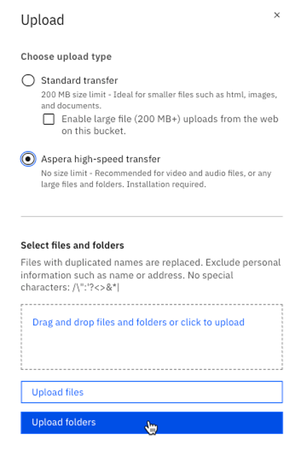{: caption="Aspera upload" caption-side="bottom"}

Upload by selecting the `model-files` directory. (Do not upload the individual files).

Note:  The upload path and file structure must be followed because the RHOAI model deployment requires a path inside the bucket. This path cannot point to a root bucket. Selecting the directory will include the model path.


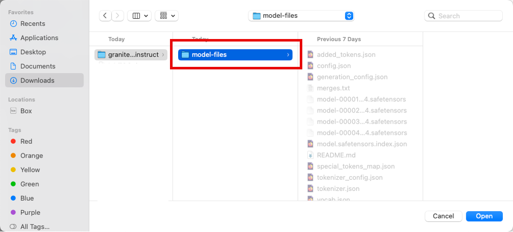{: caption="Upload model files" caption-side="bottom"}

Check upload status until it is complete.

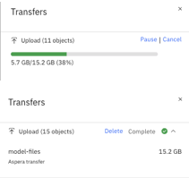{: caption="Aspera upload progress" caption-side="bottom"}

Here's how the bucket looks after upload. See how the model path ins included in the file name.

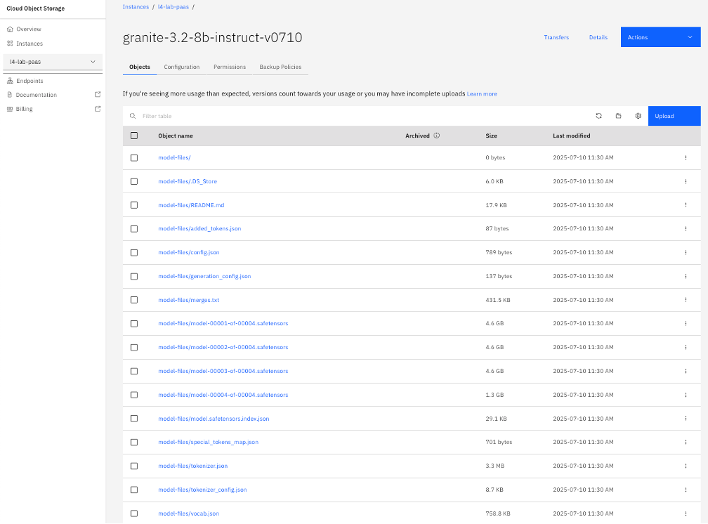{: caption="COS bucket after upload" caption-side="bottom"}

You can ignore the extra files model-files/ and model-files/.DS_Store.

From the **Configuration** tab scroll to **Endpoints** and capture the "Public" and “Direct” endpoint URL. This will be needed in configuration later.

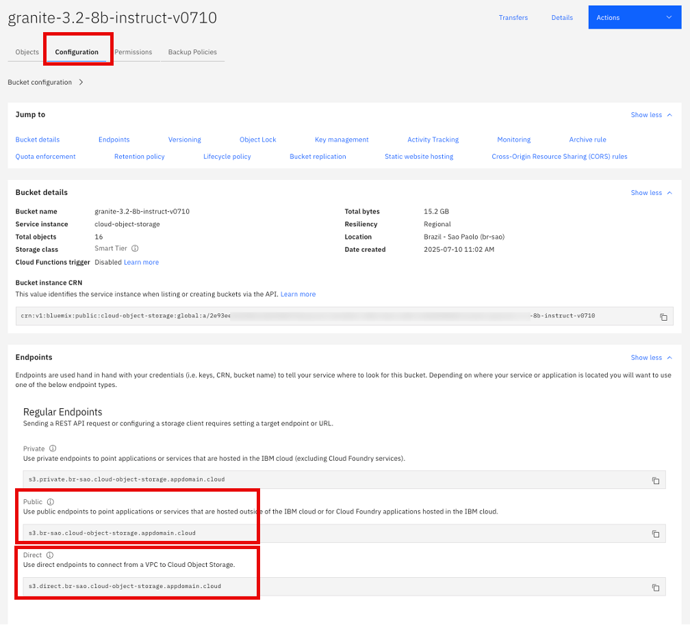{: caption="COS bucket details" caption-side="bottom"}


Create a service credential to access the COS instance and bucket contents and capture the "access_key_id" and “secret_access_key". These will be needed in configuration later


| **Input** | **Data entry/selection** |
| - | - |
| Name | l4-lab-pass-rhoai-model-serving |
| Role | Writer |
| Include HMAC credential| Yes/On |
{: caption="Configure service credential" caption-side="bottom"}

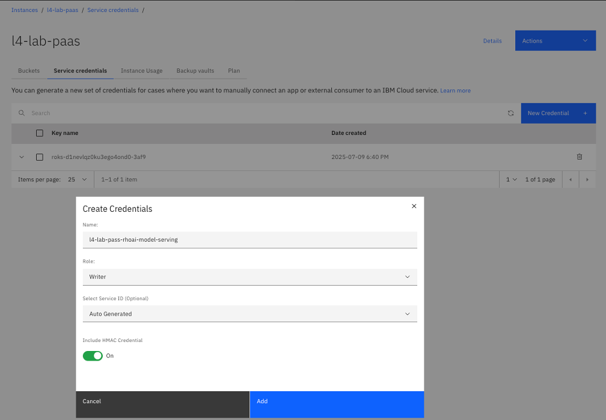{: caption="Create service credential" caption-side="bottom"}


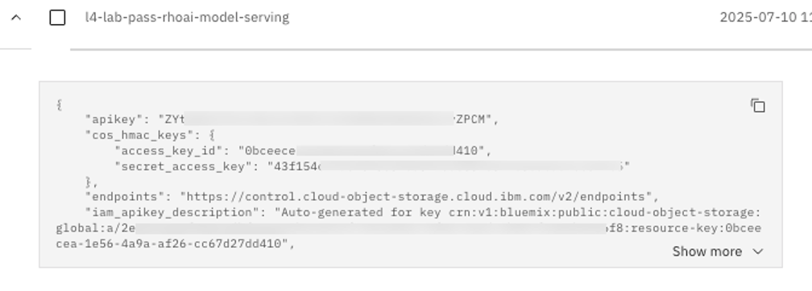{: caption="access key and secrect access key" caption-side="bottom"}


## Create a VPC in a region with two zones.
{: #deploy-model-rhoai-vpc}
{: step}

Before you create a RHOAI cluster, you must set up a Virtual Private Cloud (VPC). The VPC provides the necessary networking environment for your cluster.

To create a VPC, complete the following steps:
1. Go to the Navigation menu > **Infrastructure > Network > VPCs**.
1. Click **Create** and give the VPC instance a name. (see below).
1. Click **Create virtual private cloud**.

| **Input** | **Data entry/selection** |
| - | - |
| Geography | select decided geography \n South America |
| Region | select decided region \n Sao Paulo (br-sao) |
| Name | l4-lab-paas-vpc |
| Resource group | select resource group created earlier \n l4-lab-paas |
| Subnets - public gateway| Attach to each and all subnets |
{: caption="Configuration for VPC" caption-side="bottom"}


## Create a Red Hat OpenShift cluster
{: #sdeploy-model-rhoai-ocp_cluster}
{: step}


Create your VPC Red Hat OpenShift cluster by using the IBM Cloud console.

Navigate to the [cluster console](https://cloud.ibm.com/containers/cluster-management/clusters){: external} and click **Create cluster**.

Follow the console instructions and use the information provided below to make the cluster configurations.

Red Hat OpenShift cluster and associated worker nodes will incur costs. Check the estimates before provisioning the cluster.
{: tip}

Cluster must also meet minimum requirements for RHOAI (operating system, worker nodes etc.) listed [here](https://cloud.ibm.com/docs/openshift?topic=openshift-ai-addon-install&interface=ui#ai-min)

A GPU worker pool will be added later.

Use the information below to create the cluster.

| **Input** | **Data entry/selection** |
| --- | --- |
| Orchestrator | Red Hat OpenShift |
| Infrastructure | VPC |
| Virtual private cloud | select VPC created earlier |
| Location for worker zones | Choose zone/subnet -01 and -02. Uncheck zone/subnet -03 |
| OpenShift version | 4.18, 4.19 (see note below) |
| OpenShift Container Platform (OCP) license | Apply my OCP entitlement (or select appropriately) |
| Worker pool name | worker |
| Worker nodes per zone | 1 (i.e., x 2 zones = 2 worker nodes total) |
| Change flavor | Operating system - RHCOS \n Profile name - bx2.8x32 - 8vCPU/32GBmem |
| | _Note: If additional optional services were created for complete end-to-end security, compliance and observability, select them as needed. Otherwise follow selections from below._ |
| Worker pool encryption | Uncheck/disable |
| Network settings | Both private and public endpoints - Selected (default) |
| Internal registry Cloud Object Storage instance| select COS instance created earlier |
| Outbound traffic protection | Uncheck/disable |
| Activity tracking | Uncheck/disable |
| Cluster encryption | Uncheck/disable |
| Ingress secrets management | Uncheck/disable |
| VPC security groups | Uncheck/disable |
| Logging | Uncheck/disable |
| Monitoring | Uncheck/disable |
| Workload Protection | Uncheck/disable |
| Cluster name | l4-lab-paas-rhoai-cluster |
| Resource group | select resource group created earlier |
{: caption="Configuration for Cluster creation" caption-side="bottom"}


Note:

Make sure to [check the version comaptibility](https://cloud.ibm.com/docs/openshift?topic=openshift-ai-addon-install&interface=ui) of Red Hat OpenShift on IBM Cloud versions with the OpenShift AI add-on you will install in the following steps.

It can take up to 1 hour to provision cluster with the worker nodes.

Once deployed and all status is “green”, launch the “OpenShift web console” to confirm successful deployment.

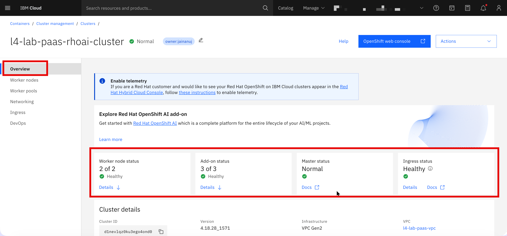{: caption="Cluster status" caption-side="bottom"}

Check the deployed worker pool.

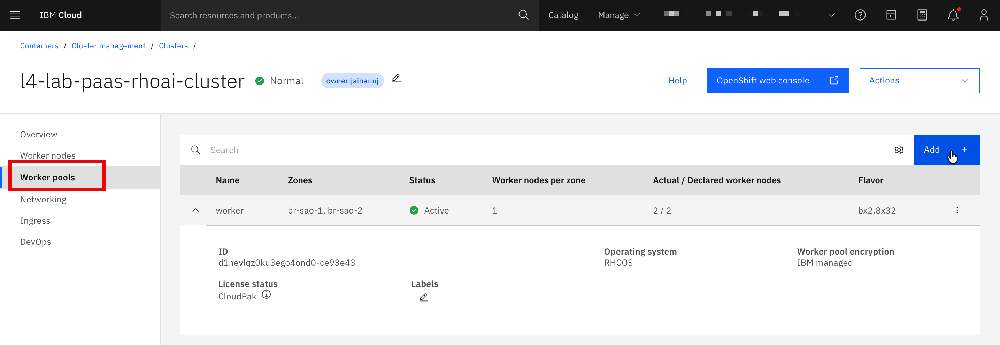{: caption="worker pool status" caption-side="bottom"}


## Add GPU worker pool to the Red Hat OpenShift cluster
{: #deploy-model-rhoai-operator}
{: step}

On the IBM Cloud console for OpenShift cluster, navigate to **Worker pools** on the left side menu and click on **Add+** to add a new worker pool.

Use the information below to create the GPU worker pool.

GPU worker nodes will incur costs. Check the estimates before provisioning the nodes.
{: tip}

Cluster must meet minimum requirements for RHOAI GPU worker nodes listed [here](https://cloud.ibm.com/docs/openshift?topic=openshift-ai-addon-install&interface=ui#ai-min).


| **Input** | **Data entry/selection** |
| - | - |
| Worker pool name | gpu |
| Worker zones and subnets | Choose zone/subnet -01 and -02. Uncheck zone/subnet -03 |
| Worker nodes per zone | 1 (i.e., x 2 zones = 2 worker nodes total)  \n This deploys two GPU worker nodes, one in each zone |
| Change flavor | Select “GPU” \n Operating system – RHCOS \n Profile name* - gx3.16x80.l4 - 16vCPU/80GB mem 1 L4 GPU card |
| Worker pool encryption | Uncheck/disable |
| OpenShift Container Platform (OCP) license | Apply my OCP entitlement (or select appropriately) |
{: caption="GPU worker pool" caption-side="bottom"}

From the work pools section, click on "Add".

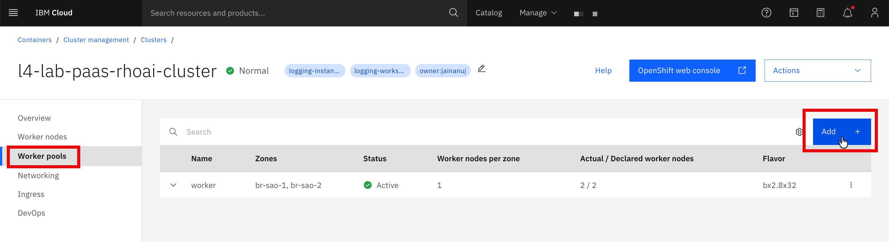{: caption="Add GPU worker pool" caption-side="bottom"}

Enter name and select two zones.

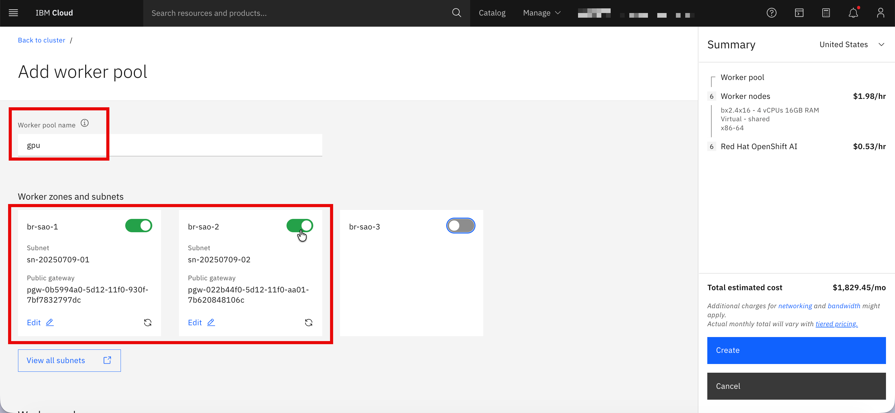{: caption="Pool name and two zones" caption-side="bottom"}

Select the gpu node profile.

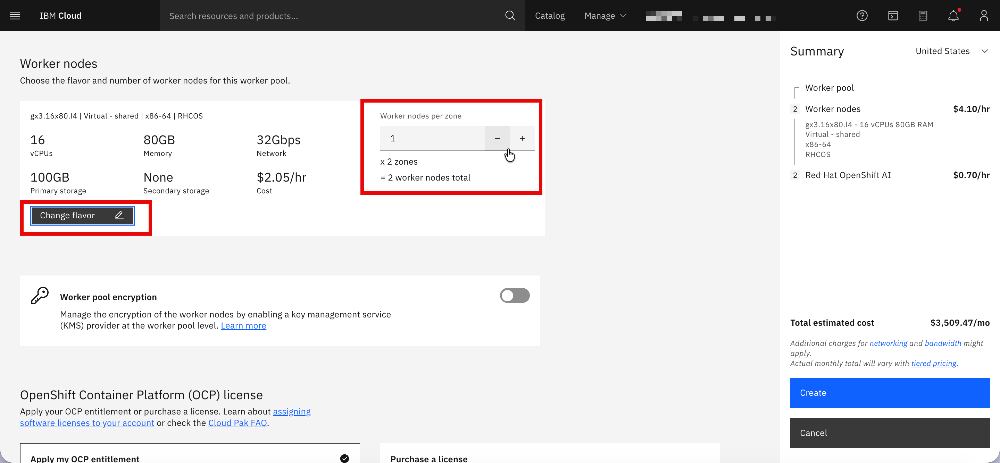{: caption="Select GPU node profile" caption-side="bottom"}

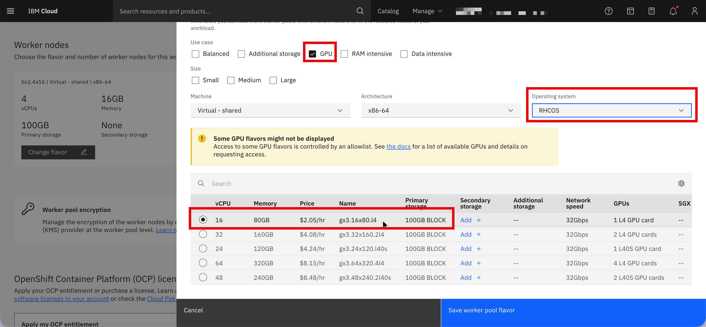{: caption="Select GPU node profile" caption-side="bottom"}

Click create.

The gpu node provisioning will take several minutes. (typically ~20 minutes). Check the progress as seen on screen below.


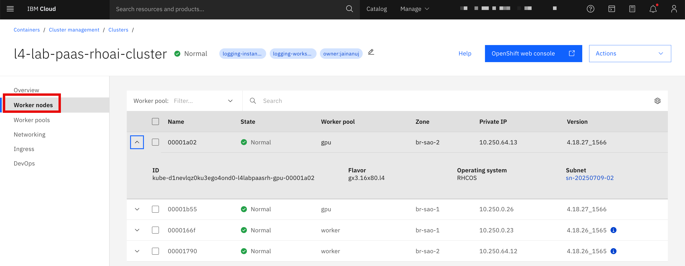{: caption="Node provisioning" caption-side="bottom"}

NOTE:

- You may choose only one zone (subnet -01) and deploy only one GPU worker node.
- The profile gx3.16x80.l4 is suitable for deploying relative small LLM e.g., granite-3.3-8b-instruct - 8b parameters. The L4 GPU has 48GB memory on the GPU and 80GB physical server memory.
- To deploy larger sized LLM models e.g., with 20b parameters or more, you will need a GPU worker node with server profile that provides GPUs with more memory. (Roughly > ~2GB per 1b param). The memory may be distributed across multiple GPUs/GPU cards on the same server node. You will also need to attach additional secondary storage to the server node.
- Refere to the available [GPU profiles](https://cloud.ibm.com/docs/vpc?topic=vpc-profiles&interface=ui#gputhe).

## Enable the Red Hat OpenShift AI add-on
{: #sdeploy-model-rhoai-ai}
{: step}

Read about [Red Hat OpenShift AI add=on](https://cloud.ibm.com/docs/openshift?topic=openshift-ai-addon-about)

Launch the IBM Cloud console for the OpenShift cluster.

Navigate to Overview > **Add-ons** > Red Hat OpenShift AI


Note:

To install the add-on select version a recent version. Make sure to [check the version comaptibility](https://cloud.ibm.com/docs/openshift?topic=openshift-ai-addon-install&interface=ui) of Red Hat OpenShift on IBM Cloud version that was deployed in the earlier step, with the OpenShift AI add-on version you are deploying.

Install the add-on. 

Once completed status on the IBM Cloud console for the OpenShift cluster will say “Normal”.
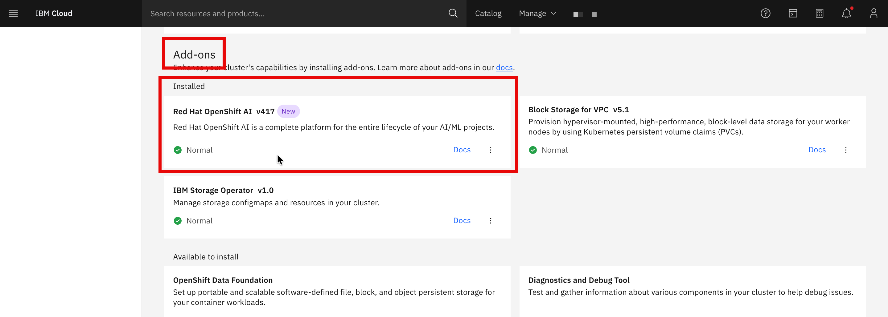{: caption="Cluster status" caption-side="bottom"}

Even after status says “Normal”, pods continue to initialize and deploy on the cluster.
To check the state of related pods and installation status of the operators deployed as part of this add-on, launch the OpenShift web console

From the **IBM Cloud console** for the OpenShift cluster, click on the **OpenShift web console** button on the top right to launch the OpenShift web console.


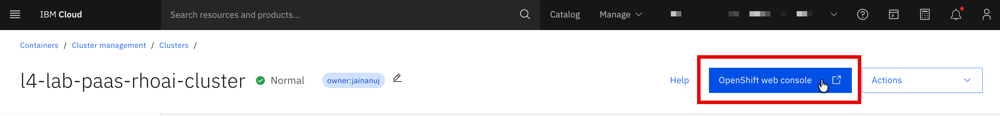{: caption="Launch OpenShift console" caption-side="bottom"}

To authenticate access, click on "Login with OpenShift".

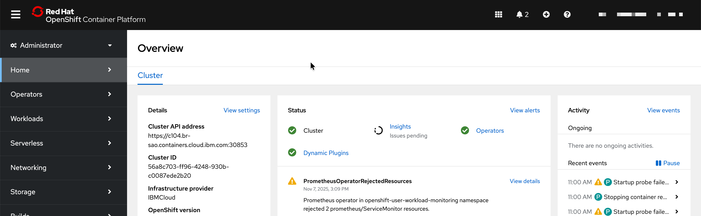{: caption="Login to OpenShift" caption-side="bottom"}


Check the status of operators and pods.

Check installed operators. They should show "Successful" status.

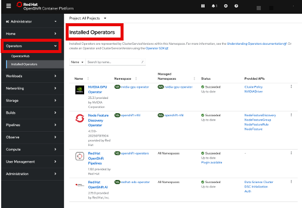{: caption="Check installed operators" caption-side="bottom"}

Many pods might still be in “Pending” or "Init" status. Wait for them to show "Complete" or "Running" status before proceeding.

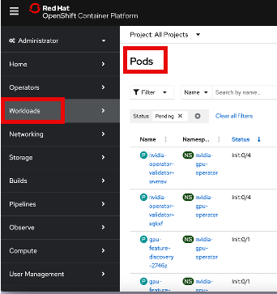{: caption="Pod status" caption-side="bottom"}


## Create NVIDIA GPU Accelerator
{: #deploy-model-rhoai-gpu}
{: step}

This accelerator is required as a selection when deploying the model.

From the OpenShift web console, launch **Red Hat OpenShift AI** console from the grid/matrix icon on the top middle. You may need to login with OpenShift.


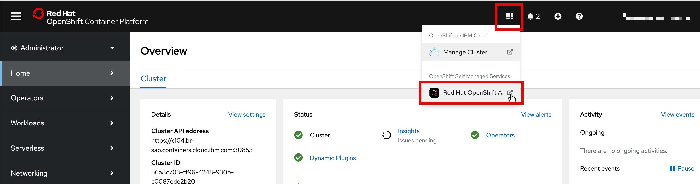{: caption="Launch OpenShift AI" caption-side="bottom"}

On the Red Hat OpenShift AI console, navigate to Settings > **Accelerator profiles**. Create accelerator profile. Use the information below.


| **Input** | **Data entry/selection** |
| - | - |
| Name | nvidia-gpu-accelerator-profile |
| Identifier | nvidia.com/gpu |
{: caption="Set accelerator profile" caption-side="bottom"}


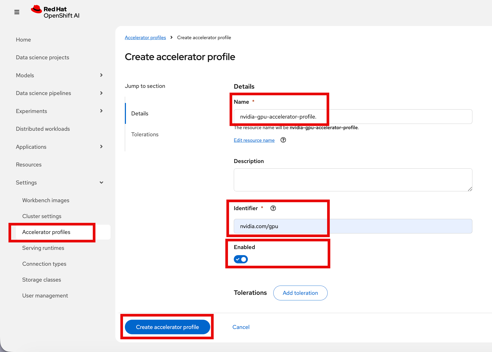{: caption="Red Hat OpenShift AI accelerator profile" caption-side="bottom"}

## Create a Data Science Project for LLM inferencing
{: #deploy-model-rhoai-projecg}
{: step}

On the Red Hat OpenShift AI console, create a new project. Click **Create project**.

| **Input** | **Data entry/selection** |
| - | - |
| Project name | aaL4Lab-v1 |
{: caption="Create project" caption-side="bottom"}

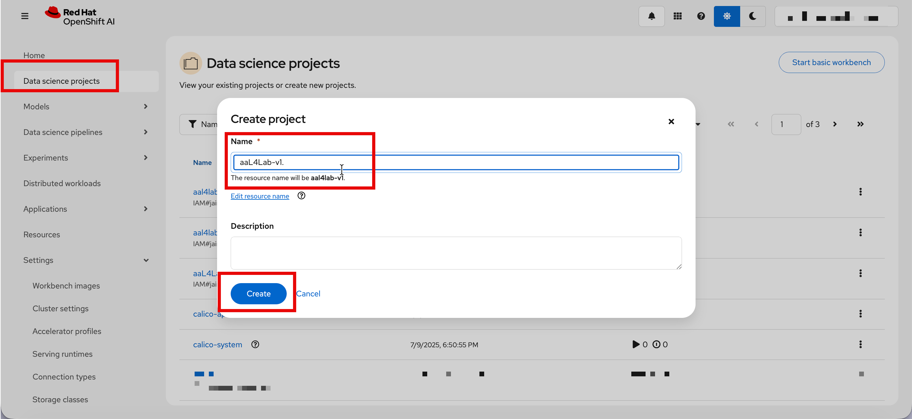{: caption="Create project" caption-side="bottom"}


## Create a connection to the COS bucket
{: #deploy-model-rhoai-cos_connection}
{: step}

In the project, create a new connection. Click **Connections** tab and create connection. Use the information below.

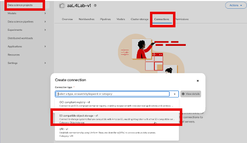{: caption="Create new connection" caption-side="bottom"}


| **Input** | **Data entry/selection** |
| - | - |
| Data Science Project | select the project created earlier \n aaL4Lab-v1 |
| Connection type | S3 compatible |
| Connection name | cos-connection-granite-3.3-8b-instruct-v0710 |
| Access key | get access_key_id from the COS instance service credential |
| Secret key | get secret_access_key from the COS instance service credential |
| Endpoint (include https://) | get from the COS instance bucket configuration \n Add https:// \n Use the “Direct” endpoint for direct access |
| Region | Use from this list for the COS region: \n br-sao |
| Bucket | get name of the COS instance bucket created earlier |
{: caption="Create new creation" caption-side="bottom"}


## Deploy the LLM model
{: #deploy-model-rhoai-deploy_model}
{: step}

In the project, click **Models** tab and **Deploy model** as single-model serving. Use the information below.


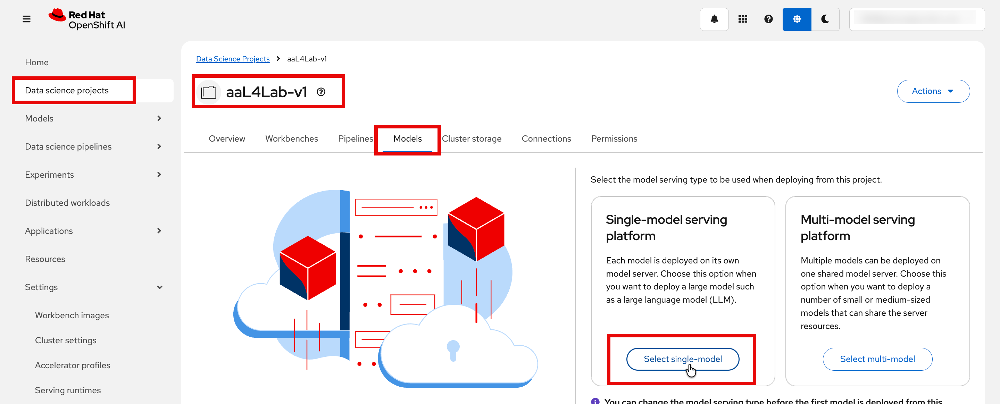{: caption="Deploy single model servering" caption-side="bottom"}

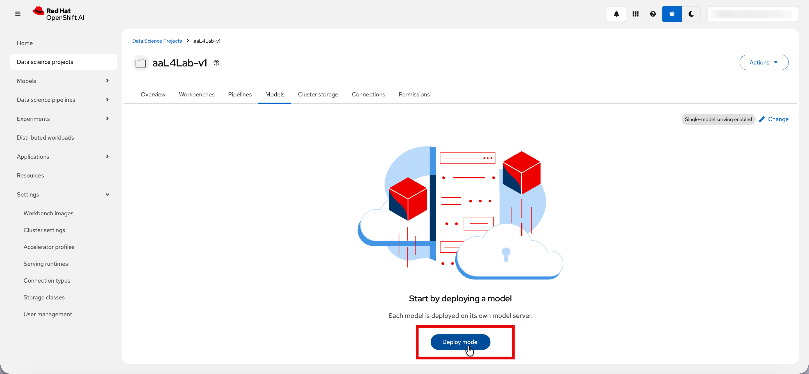{: caption="Deploy model" caption-side="bottom"}

Use this information to configure the deployment

| **Input** | **Data entry/selection** |
| - | - |
| Project | aaL4Lab-v1 |
| Model deployment name | model-granite-3.3-8b-instruct |
| Serving runtime  | vLLM NVIDIA GPU ServingRuntime for KServe |
| Model framework | vLLM  |
| Number of model server replicas | |
| Model server size | Custom \n Limits: 8 CPU, 60GiB Memory \n Requests: 8 CPU, 40GiB Memory |
| Accelerator | select accelerator profile created earlier |
| Number of accelerators | 1 |
| Model route | Select \n Make deployed models available through an external route |
| Token Authentication | Deselect/Uncheck \n Require token authentication |
| Source model location Connection | select the connection created earlier |
| Source model location Path | enter location path for model files in the bucket \n **model-files** |
| Configuration parameters | `--max_model_len=2500 --enable-auto-tool-choice --tool-call-parser=granite` |
{: caption="Configure deployment" caption-side="bottom"}


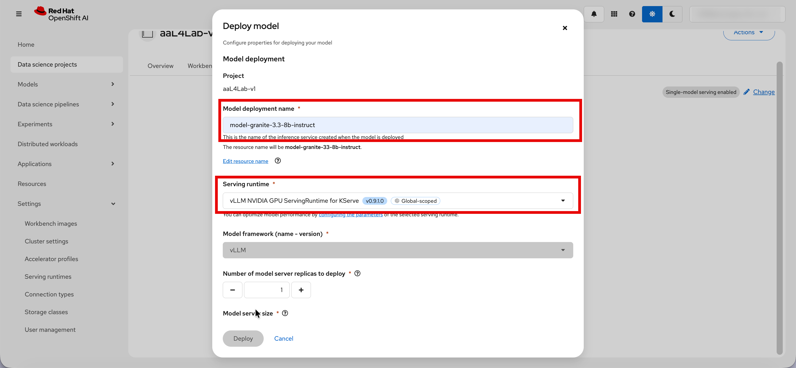{: caption="Deploy model config (1 of 4)" caption-side="bottom"}
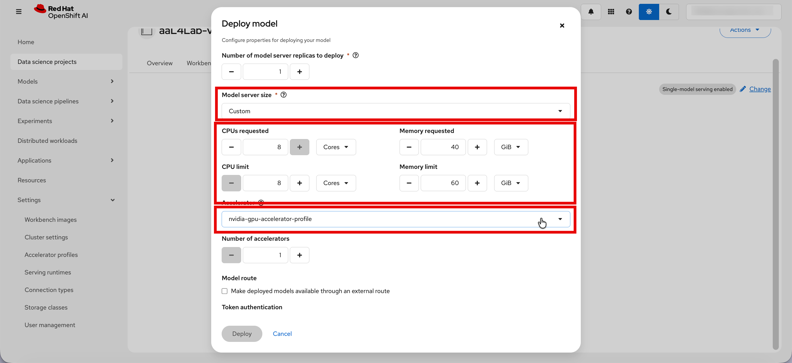{: caption="Deploy model config (2 of 4)" caption-side="bottom"}
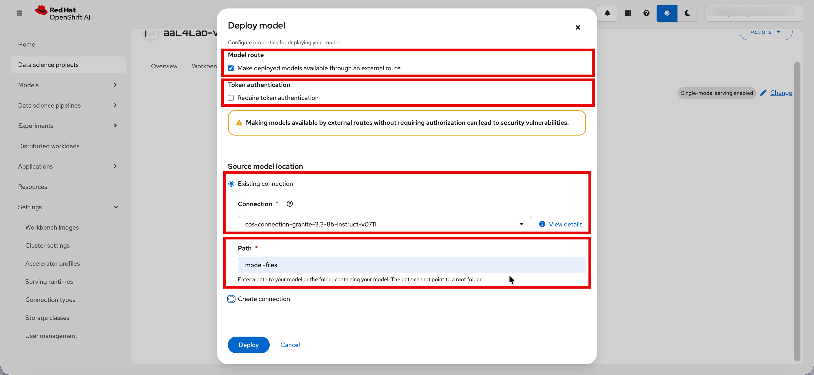{: caption="Deploy model config (3 of 4)" caption-side="bottom"}
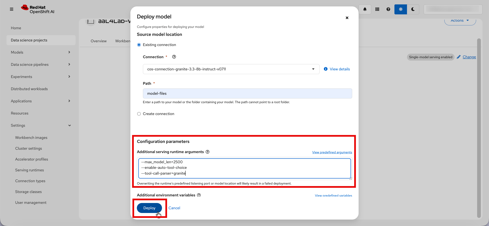{: caption="Deploy model config (4 of 4)" caption-side="bottom"}

Click "Deploy" and check the "Status". Once deployed successfully, status changes to green checkmark.

Note the external inferencing endpoint for the deployed model. You will need it in the next step.

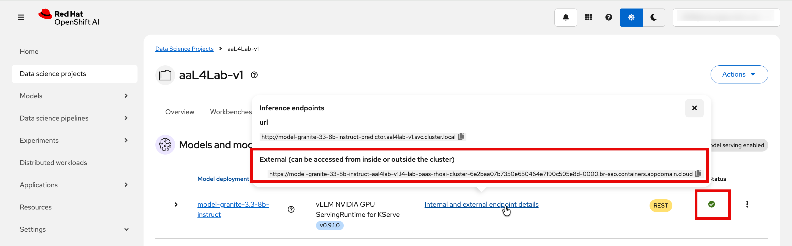{: caption="Deploy model complete" caption-side="bottom"}


NOTE:

- When using GPU worker node with multiple GPUs
   - Change to number of accelerators to match the number of GPUs on the node.
   - Add configuration parameter `--tensor-parallel-size` and set it to match the number of GPUs.
- Depending on the model, GPU memory and performance requirements adjust other configuration parameters. A higher `--max_model_len` needs more available GPU memory.


## Verify the LLM model by inferencing
{: #deploy-model-rhoai-verify}
{: step}


Append `/docs` to the external inference endpoint of the deployed model.. For example:

```text
https://model-granite-33-8b-instruct-aal4lab-v1.l4-lab-paas-rhoai-cluster-XXXXXXXXXX-0000.br-sao.containers.appdomain.cloud/docs
```
{: codeblock}

Open the inference endpoint in bowser to get the complete list of OpenAPI endpoints for inferencing the deployed model.


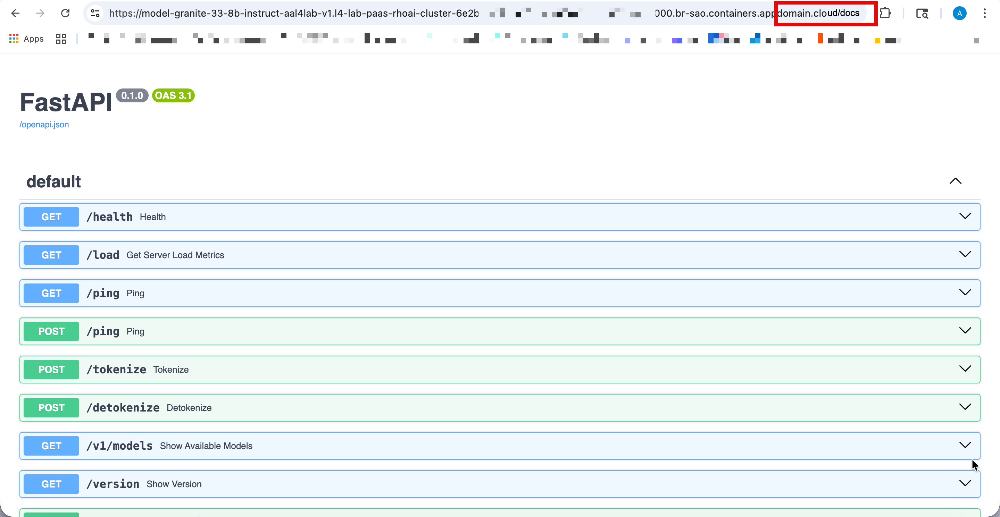{: caption="List of OpenAPI endpoints" caption-side="bottom"}


Use the `/v1/models` endpoint to list the deployed model name. For example:

```text
https://model-granite-33-8b-instruct-aal4lab-v1.l4-lab-paas-rhoai-cluster-XXXXXXXXXX-0000.br-sao.containers.appdomain.cloud/v1/models
```
{: codeblock}

Capture the model name/id, e.g. “model-granite-33-8b-instruct” This will be needed in steps later.

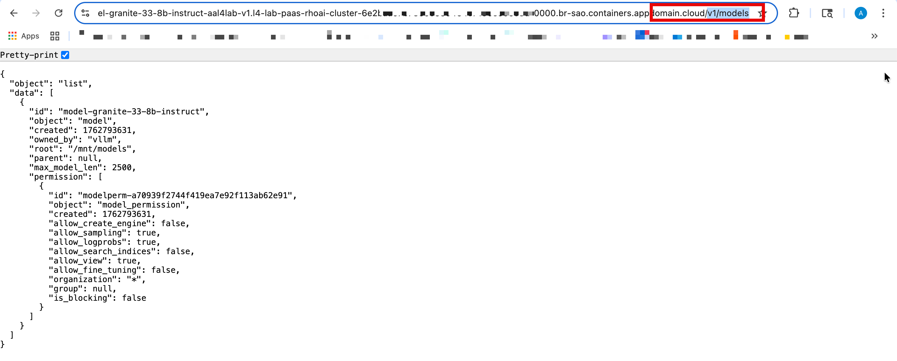{: caption="Model name and id" caption-side="bottom"}

Use the `/v1/chat/completions` endpoint to list the deployed model name.

This is a POST call so use cURL. For example:

```text
curl https://model-granite-33-8b-instruct-aal4lab-v1.l4-lab-paas-rhoai-cluster-XXXXXXXXXX-0000.br-sao.containers.appdomain.cloud/v1/chat/completions \
    -H "Content-Type: application/json" \
  	-d '{
      "model": "model-granite-33-8b-instruct",
      "messages": [
        {
          "role": "developer",
          "content": "You are a helpful assistant."
        },
        {
          "role": "user",
          "content": "capital of usa is"
        }
      ]
  }'
```
{: codeblock}

Chech the output.

```text
{
  "id":"chatcmpl-ba28…143b","object":"chat.completion","created":1752174978,
  "model":"model-granite-33-8b-instruct",
  "choices":[{
    "index":0,
    "message":{
      "role":"assistant","reasoning_content":null,
      "content":"The capital of the United States is Washington, D.C. While D.C. isn't a state, it's a federal district, and serves as the seat of the U.S. federal government. It's located on the east coast of the United States, along the Potomac River, bordering Maryland and Virginia.",
      "tool_calls":[]
    },
    "logprobs":null,
    "finish_reason":"stop",
    "stop_reason":null
  }],
  "usage":{
    "prompt_tokens":74,
    "total_tokens":152,
    "completion_tokens":78,
    "prompt_tokens_details":null
  },
  "prompt_logprobs":null
}
```
{: codeblock}

 Above output confirms successful provisioning, configuration and inferencing of LLM deployed on Red Hat OpenShift AI cluster.

 The inferencing endpoint can now be used by other applications.

 End of tutorial. Thank you.

### Summary
{: #summary}

In this tutorial on IBM Cloud, you have provisioned a Red Hat OpenShift cluster with AI add-on with following features:

* Cluster spans 2-zones of a region.
* Worker pool: single worker node per zone, i.e., total 2 worker nodes.
* Worker node profile: bx2.8x32 - 8vCPU/32GB mem.
* GPU worker pool: single GPU worker node per zone, i.e., total 2 GPU worker nodes.
*  GPU worker node profile: gx3.16x80.l4 - 16vCPU/80GBmem 1 L4 NVIDIA GPU.
* Model deployed: granite-3.3-8b-instruct.

The deployment provided an LLM inferencing endpoint for use with AI/Gen AI applications.
